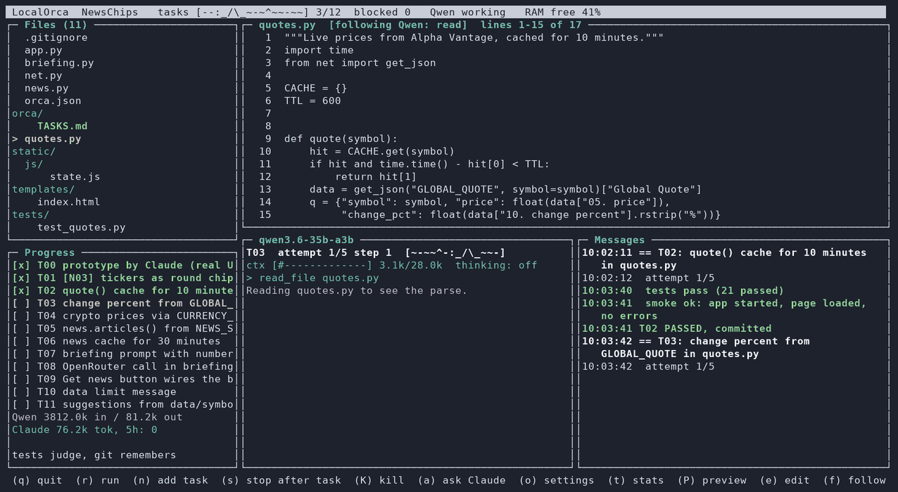
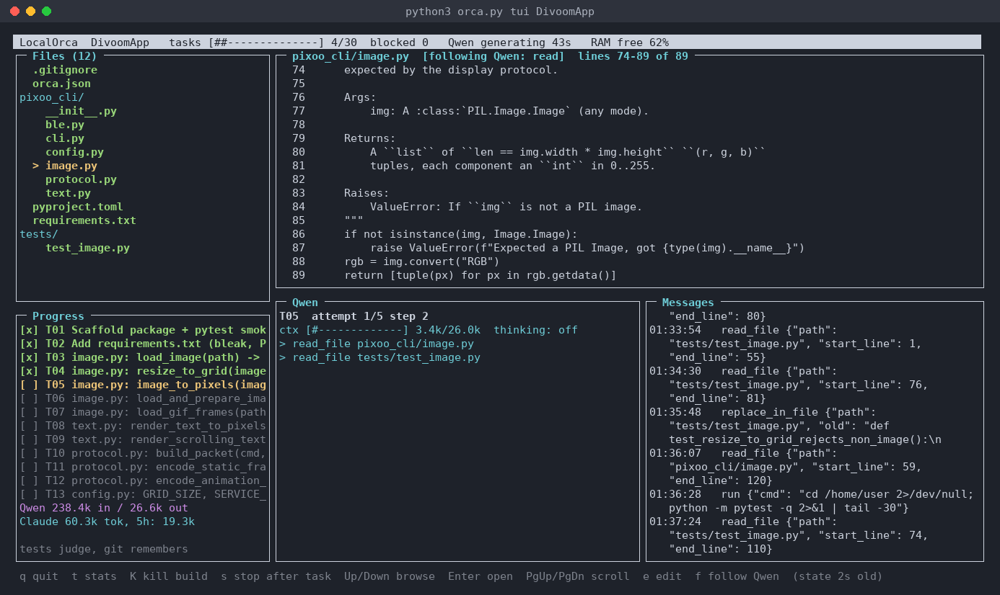
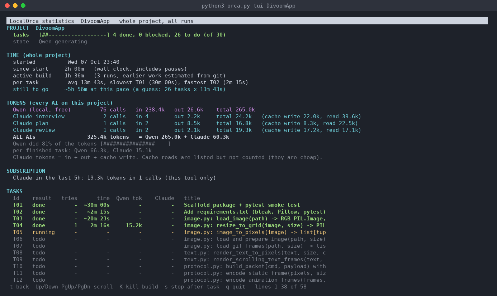

# LocalOrca

Claude designs. You shape it. Qwen builds. Tests judge. Python stdlib only.

A local model (Qwen 3.6 35B-A3B in LM Studio) does the long, boring build work for free on a Mac Mini. Claude researches, builds the prototype (the real UI and a walking skeleton with green tests), lets you look at it and leave notes, then breaks the rest into small tasks for Qwen. It checks the RUNNING app every few tasks and steps in when Qwen gets stuck. Tests are the judge, git is the memory.

Landing page: [lastmachine.com/localorca](https://lastmachine.com/localorca/). The whole story and the numbers: [Qwen, Claude and Mac Mini: A love (code?) story](https://jon.io/qwen-claude-and-mac-mini).

## What you need

1. A Mac Mini (or any Apple Silicon Mac) with 32 GB.
2. [LM Studio](https://lmstudio.ai) with `qwen/qwen3.6-35b-a3b` downloaded, loaded with a 32k context, local server on (port 1234).
3. [Claude Code](https://claude.com/claude-code), logged in (a $20 subscription is enough).
4. Python 3.9+. Nothing to pip install. Optional, for the real-app browser check: `python3 -m venv .smoke-venv && .smoke-venv/bin/pip install playwright && .smoke-venv/bin/playwright install chromium`

## ENOUGH WITH TALKING. LET'S BUILD

    git clone https://github.com/jonromero/localorca.git && cd localorca
    python3 orca.py new ~/proj/pomodoro "A pomodoro timer web app: 25/5 cycles, one big start button, daily stats"

That's it. Claude researches and builds the prototype while the dashboard shows every file it writes. When it is ready, a popup tells you what to press: `P` to open it, `n` to leave a note, `h` to hand it off to Qwen. Close the dashboard any time (the build keeps running) and come back to watch:

    python3 orca.py tui ~/proj/pomodoro --run

`--run` is safe to always add: it opens the running build if there is one, starts the build if there isn't (handy after you add tasks), and in the design stage builds the prototype if there is none yet.

> Hey, the notes below are Claude-generated, based on my thoughts during development. There are some amazing insights in here that I didn't want to summarize, in case you are interested. I'll extract some gems in the future.

## Flow

    python3 orca.py new ~/proj/myapp                 # interview, then the DESIGN STAGE opens in the dashboard
    #   Claude researches + builds the prototype (real UI, walking skeleton, green tests), you watch it live
    #   (P) look at it, (n) add notes (or Feedback in the preview), (b) Claude applies them, repeat
    #   (h) hand off: Claude breaks the rest into small tasks, your open notes first, and Qwen starts
    python3 orca.py new ~/proj/myapp --qwen-only     # the old flow: Claude plans every task, Qwen builds from an empty folder
    python3 orca.py new ~/proj/myapp "short idea" --interview
    python3 orca.py new ~/proj/myapp --brief-file brief.md   # skip the interview
    # 2 minute human gate: read orca/TASKS.md and orca.json (test_cmd!)
    caffeinate -i python3 orca.py run ~/proj/myapp
    # later: keep improving = add tasks to orca/TASKS.md and run again. `new` on an existing project refuses (needs --force)

Interview mode: you give a rough idea, Claude asks 3 to 6 questions (each with a default), you answer
(finish a message with an empty line), and it loops until Claude drafts a brief you like.
`/go` accepts the draft (or tells Claude to stop asking and draft now), `/quit` aborts.
The accepted brief is saved to `orca/BRIEF.md` and the transcript to `orca/interview.md`.

Then `new` asks Claude (`claude -p`) for SPEC.md, a one-line-per-task TASKS.md, and a test command.
`run` loops: next task -> fresh Qwen context -> tools (read/write/replace/run) -> tests -> commit.
Add `--go` to `new` to skip the gate (not recommended for the first run).

Dashboard (curses, nothing to install): `python3 orca.py tui ~/proj/app --run` starts the build in the background and opens panels for Files (recently touched files in green), Current file (live contents), Qwen (phase, context fill, last tool calls, thinking and reply), Messages, and Progress (tasks, tokens). In the design stage the left panel shows the prototype and your notes, the Claude panel shows what Claude is doing, and the keys are `(P)` see the prototype, `(n)` add a note, `(b)` Claude builds or applies notes, `(h)` hand off to Qwen. Build stage keys (shown in brackets at the bottom of the dashboard): `(q)` quit, `(r)` run the build when none is running (handy after adding tasks to a finished project), `(n)` add a task for Qwen (like the preview's Feedback button: it goes to the front, right after the task running now, `1. ... 2. ...` makes several, committed at once), `(s)` stop after the current task, `(K)` kill the build process (and the live preview with your app), `(a)` ask Claude: a small box inside the dashboard, read-only (Claude can look at files, never change them), the project's small model, follow-ups keep the context; capital `A` (in the box on an empty line, or straight from the dashboard) opens the full Claude Code session in the project folder, `/exit` returns, `(o)` settings menu (models, context, folders), `(t)` statistics, `(P)` live preview, `(L)` pick the models, `(C)` set the context (how much chat Qwen may hold per attempt, 28k by default, live), `(D)` extra folders Qwen may read, `(e)` edit the selected file, `(f)` follow Qwen. Quitting the dashboard does NOT stop a build started with `--run`; reopen it any time with `tui ~/proj/app`. Needs a terminal of at least 90x24. Build output goes to `orca/run.out`.

Editing: `e` (or double click) opens the selected file in your `$EDITOR` (VS Code: `EDITOR="code -w"`). If you changed it while a build is running, the dashboard asks what should happen: keep it and tell Qwen (a note goes into PROGRESS.md), keep it and PROTECT it (Qwen's write_file and replace_in_file on that file are refused until the current task ends), undo your change, or keep it and stop after this task. With no build running it just saves and notes it for Qwen.

Simple log view: open a second Terminal tab and run `python3 orca.py watch ~/proj/app` (progress bar, current task and step, what Qwen just did, context fill, RAM, usage, recent log and commits; refreshes every 2s; Ctrl-C closes it, the run keeps going).

Other commands: `usage <dir>`, `status <dir>`, `review <dir>` (a course check now). Create `orca/STOP` to halt after the current task.

## Design stage (Claude builds the prototype, you shape it, then Qwen)

Why: Qwen's failures cluster at the START. Wiring a whole app together and the first end-to-end test is exactly what a small model is bad at, and exactly what Claude is good at. Later tasks on a running, tested app ("add a score counter") are what Qwen does well, for free. So Claude spends its tokens once, up front, instead of on rescues and course checks later.

1. **Research.** Claude searches the web (current stack and library versions, how similar products work, UI patterns, pitfalls) and writes `orca/RESEARCH.md` and the spec. The spec now has `## Screens`, `## Files` and `## Conventions`, so Qwen copies one pattern.
2. **Prototype.** Claude works in the project folder with file tools and builds the REAL UI (every screen, real layout and styling, sample data where logic is missing, `TODO(qwen): ...` marks at those spots) plus a walking skeleton (one core path works end to end). Small files, tests green. You watch it in the dashboard: every file it writes, every command it runs, its notes.
3. **Checks.** LocalOrca runs `test_cmd` and the real-app check itself. If they fail, the failure goes back to the SAME Claude session (it remembers what it did), up to `design_fix_rounds` (2) times.
4. **You review.** The live preview opens. Leave notes with `(n)` in the dashboard, or the Feedback button in the preview (in this stage it adds a design note, not a Qwen task). `1. ... 2. ...` makes several notes. `orca.py note DIR "text"` works too.
5. **Revise or keep.** `(b)` has Claude apply all open notes now (a new prototype revision). Or leave notes open: at hand-off they become Qwen's FIRST tasks.
6. **Hand-off** `(h)`, or `orca.py handoff DIR --go`. It refuses unless tests and the real-app check are green (Qwen never starts on a broken base, and no Claude tokens go into planning one). Claude reads the code and writes the task list against REAL files: open notes first (`T01: [N03] ...`), then vertical slices that replace the TODO(qwen) marks. The prototype becomes a done `T00`, the real-app check is on from Qwen's first task, and the build starts.

Tokens: every Claude call in this stage logs its EXACT counts to Messages (`CLAUDE TOKENS prototype: 1,234,567 in, ...`), taken from Claude Code's own per-model totals (`modelUsage`, which also counts the small side model Claude Code uses). A killed call still counts, from its per-message usage. The running total shows in the Design panel, after every round and at hand-off, and every call is a line in `orca/design_usage.jsonl` (kept in git, so you can compare builds later). While Claude works, the orca progress bar swims in the Claude panel header, the same one Qwen's panel shows (time spent is in `(t)` stats). It is the progress bar everywhere: the task bar at the top of the dashboard (it swims right as tasks finish and SPLOOSHES at 100%), model loading, the Qwen panel while it works, `watch`, and the spinner of `new`, plan and review in the terminal (no percentage = it swims back and forth).

Your turn: when the dashboard waits for you, a popup says what to do, once (remembered in `orca/popups_seen.json`): prototype ready (Claude's TRY steps, then the keys: `P` opens the browser, `n` note, `b` apply notes, `h` hand off), prototype not green (`b` fix, `a` ask Claude), and in the build stage a halt after blocked tasks (`a`, `t`, `r`). A key in the popup does the action; Esc means later. The Design panel keeps a NEXT list too.

Files: `orca/STAGE` (design or build), `orca/RESEARCH.md`, `orca/design_usage.jsonl`, `orca/DESIGN_NOTES.md` (`[ ]` open, `[x]` applied by Claude, `[>]` handed to Qwen), `orca/PROTOTYPE.json` (revision, green or not, Claude's summary). Projects made before this have no STAGE and stay in the build stage. `run` refuses while a project is in the design stage. Settings: `design_timeout` (2700 s per prototype build or revision), `design_fix_rounds` (2), `design_unload_model` (true: the design stage never uses Qwen, so it unloads LM Studio's model to give Claude's builds and headless browser the RAM, unless another LocalOrca build is running. Nothing loads Qwen until the hand-off starts the build). Claude Code runs with `--permission-mode acceptEdits` and only the file, shell and web tools during design; the hand-off planner gets read-only tools.

## Safety rules (tested)

Every rule below exists because it went wrong in a real build, and each one has a regression test in `tests/` (`test_guards.py`, `test_design.py`) (fake LM Studio, fake Claude, runs in seconds, also on every push via GitHub Actions). Run them before you change orca.py: `python3 -m unittest discover -s tests -v`.

1. **A task is only done if the code changed.** Passing tests alone prove nothing when the old tests were already green. An attempt that changes no file fails with "NO CHANGES" (a fix task R/F may pass unchanged only if the model explicitly says it was already done). Test caches do not count as work, and a tree that was already dirty before the attempt does not count either. (Real failure: 7 features "done" with zero lines written.)
2. **Read loops are broken.** Re-reading the same part of a file is flagged, and after 10 calls without writing, the model is told to write the code now.
3. **The history marker is never written into a file.** (Real failure: Qwen copied "<1354 chars>" into a test file.)
4. **No `cd` out of the project, no whole-disk searches, no sudo, git push/reset, or pipe-to-shell.**
5. **Files outside the project, `.git` and `orca/` are off-limits to the model. Extra folders are read-only.**
6. **No code reviews:** they were removed. On IslandSurvivor 141 of 208 task runs were review fixes (5.4 of 11.6 hours, about 1M Claude tokens) and the page was still blank, because a diff review never looks at the product. The course check (rule 20) replaced them.
7. **Plans are testable:** every "done when" must be checked by the test command, never "in the browser".
8. **`new` never overwrites an existing project** without `--force`.
9. **Claude is asked for help after 3 failed attempts** even when every failure looks different (close-but-not-quite loops), not only after the same failure 3 times.
10. **Nothing is lost on a block:** the saved `orca/failed/T##.diff` includes NEW files too (`git apply` brings the attempt back), and Claude's rescue sees the new files, not just edits. (Real failure: a 276-line test file and the whole actions.js vanished from both.)

11. **Every task starts with a map of what exists,** so the small model does not re-read finished files to learn their names. (Real failure: 7 files read, 14k of 22k context spent, zero lines written.)
12. **Plans use small tasks:** one function (or 2 or 3 tiny ones), one test file, at most 3 behaviours per "done when". (Real failure: one task bundling six actions got blocked and threw away the five that worked.)

13. **A finished build explains itself:** `orca/REPORT.md` is written at the end of every run (and by `orca.py report`), so waste, blocks and weak tests are visible instead of guessed.
14. **Small files:** the planner asks for one file per function group, about 150 lines (a folder of small files plus an index when a group grows, never "part 1 / part 2" of one file). A file over `file_warn_lines` is marked TOO BIG in the code map with "do not read it whole, use line ranges, put new code in a new file when the task allows". (Real failure: a 486 line actions.js that Qwen could neither read in one step nor rewrite in one reply.)
15. **Claude teaches while it helps:** when the escalation call spots a repeating mistake pattern that LESSONS.md does not cover, it ends with one `LESSON: <general rule>` line. LocalOrca strips that line from the hint, adds the rule (max about 25 words, no task ids, skipped if it repeats an existing lesson) to this project's `orca/LESSONS.md`, and every later task sees it. Same call, no extra tokens to speak of. Turn it off with `"escalate_lessons": false`.
16. **A rollback never touches your notes:** a blocked task undoes the code only. Edits you made to `orca/TASKS.md`, `SPEC.md` or `LESSONS.md` while it ran, and lessons just added, are kept. (Real bug found by a test: the old `git reset --hard` wiped them.)
17. **Files stay small while the build runs:** after a passing task, if a source file is over `file_warn_lines` (default 200), LocalOrca queues ONE fix task before the next task: split it into small modules and keep the original as a thin re-export so imports still work. One split task per file, ever (a blocked split is not retried), biggest file first, test files never. Turn it off with `"auto_split": false`. (Real failure: a 584 line actions.js.)
18. **The real app must run, from the start:** new plans build a walking skeleton first (a crude app that really runs), then vertical slices. From the skeleton task on, every task also passes a real-app smoke test (real server, real headless browser, no fakes). See "Walking skeleton" below. (Real failure: 170 green tasks and a blank page, because every test injected a fake game state.)
19. **Long silent steps show they are alive:** `orca.py new` prints what it is doing, a spinner with the elapsed time on a terminal (a line every 15 seconds in a log), and a summary of what came back (SPEC lines, task count, config keys). Same for the interview answers.
20. **Course check, so the build heads for a working app:** right after the skeleton task passes, then every `checkpoint_every` (8) passing tasks or `checkpoint_minutes` (90), Claude gets a screenshot of the REAL running app, its console errors, the spec, the task list and the build numbers. It answers STATUS (what works now) and DEMO (shortest path to something usable), and may REMOVE, ADD or MOVE open tasks only, at most 5 added and 5 removed per check. Changes apply automatically and are written to `orca/CHECKPOINT.md` (git keeps the old list). `"checkpoint_every": 0` turns it off.
21. **Qwen never starts on a broken base:** the hand-off from the design stage runs the tests and the real-app check first and refuses if either is red, before any Claude tokens go into planning. (Real failure: red baseline tests on IslandSurvivor made every later task fail.) Tests in `tests/test_design.py`, with a fake Claude that streams like the real one.
22. **A timed-out command takes its children with it:** every command runs in its own process group, and a timeout or Ctrl-C kills the whole group. (Real failure: timed-out `node --test` runs stayed alive for days.)

## House rules (your standing taste)

`house_rules.md` next to orca.py is given to Claude every time it interviews you and plans a new project. Put your standing preferences and lessons there, so every plan starts from them instead of Claude's defaults. It ships with rules learned the hard way:
- pick the stack that gives the local model the most automatic feedback: TypeScript checking for JS (`tsc --noEmit` in test_cmd), type hints plus mypy for Python, no Rust/C++ unless needed, boring common libraries, no bare CDN URLs,
- every "done when" is checked by test_cmd, never "in the browser",
- small files, few dependencies, .env git-ignored from the start.

A project can add its own `house_rules.md` in its folder (read after the global one). After planning, `new` prints the chosen STACK and test_cmd so you can catch a wrong choice in the 2-minute review, before a single line is built. Changing the stack later is expensive.

## The orca/ folder: steering the build

Every project gets a visible `orca/` folder (older versions used a hidden `.orca`, the next `run` moves it for you and keeps the git history). The dashboard's Files panel shows its notes, so you can open them with Enter and edit them with `e`. Qwen and Claude re-read these files all the time, so edits count from the next task on, no restart needed.

1. **`orca/TASKS.md`: WHAT gets built.** The to-do list. The build always takes the first `[ ]` task.
   - Skip a task: delete its line, or mark it `[x]` (done) or `[!]` (blocked).
   - Reorder: move lines up or down.
   - Add one: `- [ ] T31: what to do | done when: what the test checks`
2. **`orca/SPEC.md`: what the product IS.** Every Qwen prompt includes it and the course check steers against it. If you drop a feature, say so here too, otherwise a course check may notice it missing and add tasks back:

       ## Out of scope (v1)
       - No animation: no GIFs, no scrolling text. Static images and static text only.

3. **`orca/LESSONS.md`: HOW to work.** Rules included in every prompt under "follow these". Claude's escalation hints add lessons here too. When the file gets long, the LOCAL model shortens it (checked: it must stay a bullet list of sane size, else the newest lessons are kept).

       - For fonts use ImageFont.load_default(). Never search the disk.
       - Keep functions small, add a test for every function.

Safest way to edit: press `(s)` (stop after the current task), edit with `(e)`, then `(r)` to run again. Editing while it runs also works, the files are re-read between tasks.

4. **`orca/MAP.md`: what EXISTS (automatic, do not edit).** After every passing task LocalOrca rebuilds a map of the project: each source file with its exported functions and signatures, test files as a count. Every Qwen prompt carries it as the CODE MAP, so the model does not spend its first steps re-reading files that earlier tasks finished (its context is small). It is built from the files with plain regex (JS/TS exports, Python top-level `def`/`class`), never by a model, so it cannot be wrong or stale. Files the current task names are shown in full, the rest shrink to bare names if the map outgrows `map_max_chars` (default 6000, about 1.5k tokens). `vendor/`, `node_modules/` and `.min.` files are skipped.

Also in `orca/`: `PROGRESS.md` (what got done), `BRIEF.md` and `interview.md` (from `new`), `CHECKPOINT.md` (what each course check saw and changed), `failed/` (diffs of blocked tasks), and runtime files that are git-ignored (`state.json`, `events.log`, `run.out`, `usage.json`, `sessions.jsonl`, `tasks.jsonl`, `run.pid`, `logs/`).

## Where Claude steps in
1. The design stage (once): research, the prototype, your notes, the task list at hand-off.
2. A stuck task: after 3 failed attempts, Claude reads the diff and the error and writes a hint (max 2 per task). It may add one `LESSON:` to `orca/LESSONS.md`.
3. Course checks on the running app (below).

## Course checks instead of code reviews
Right after the skeleton task, every `checkpoint_every` (8) passing tasks, every `checkpoint_minutes` (90) and once when all tasks are done, Claude looks at a screenshot of the running app and steers the OPEN tasks toward a usable demo (rule 20). `python3 orca.py review DIR` runs one by hand.

## Usage (tokens per model)
`python3 orca.py usage <dir>` (also in `status`, the dashboard, and at the end of every `run`):
- Qwen: calls, prompt and completion tokens from LM Studio. Free.
- Claude: tokens in/out/cache per purpose (interview, plan, escalate, checkpoint), plus a rolling 5 hour window (`quota_window_hours`), which is the cycle subscription limits reset on. Dollars are hidden by default (`show_cost: true` shows API-equivalent cost, which means nothing on a subscription).
- **Real subscription %:** LocalOrca reads the same plan usage Claude Code's `/usage` screen shows (5 hour window and weekly limit) by asking Anthropic with your existing Claude Code login. It shows in `usage`, the dashboard (top bar and Progress panel), and the log at each task start. "today" is the weekly % used since local midnight, worked out from samples saved in `~/.localorca/quota.jsonl`, so it counts ALL your Claude use (chat, Claude Code, this tool) as long as something sampled it. Check it works with `python3 orca.py quota --raw`.
- Caveats: this uses an undocumented endpoint (it can change or break), reads the token from `~/.claude/.credentials.json` or the macOS Keychain (macOS may ask permission once), never refreshes the token, and sends it only to api.anthropic.com. If the token expired, open Claude Code once. Turn it off with `"quota_check": false`.

## Thinking
Your Qwen template thinks by default at the highest effort (`xhigh`, "validate key assumptions, consider alternatives"). That is slow for an agent loop and long thinking can use up `max_output_tokens` before the tool call. LocalOrca sends the template's own switches:
- `"thinking": "off"` (the default) for attempts 1 and 2, `"thinking_retry": "medium"` from attempt 3 (`thinking_retry_from`). Values: `off`, `low`, `medium`, `xhigh`, `default` (send nothing).
- With `"thinking": "off"` it probes LM Studio at the start. If thinking is still on it reloads the model once (a changed prompt template only counts after a reload), probes again, and warns if it is still on.
- The Qwen panel shows the current mode and the model's thinking (dim text). If a reply is cut off at the token limit, the log says so.
Whether LM Studio passes these through depends on the version. If the log warns that it ignored them, or the dim thinking text never shrinks, set it in the model's template instead (LM Studio, model settings, Advanced, Prompt Template, Jinja). Two edits:
- Lower the default effort: change `reasoning_effort|default('xhigh')` to `reasoning_effort|default('low')`.
- Turn thinking off: change `` to ``, and `` to ``.
Reload the model after editing the template.

## Model selection
At the start of `run` the script picks the model itself (unless `"model"` is pinned in orca.json):
1. Lists everything downloaded in LM Studio (native API). Drops embeddings, anything under `min_model_b` (20) or over `max_model_b` (32) billion params.
2. If exactly one suitable model is already loaded, it keeps that one (your manual choice wins).
3. Otherwise it picks: text models beat vision models, then the order in `model_prefer` (default `["27b", "30b|32b"]`, regexes, best first), then bigger. It runs `lms unload --all` and `lms load <model> --context-length 32768 --gpu max -y`.
4. Nothing suitable? It stops and tells you instead of running a 7B.
Put `"model_prefer": ["coder", "27b"]` first to favor a coding model. Pin with `"model": "qwen/qwen3.8-27b"`. Needs LM Studio running with the server on, and the `lms` CLI (found in ~/.lmstudio/bin automatically).

## Python venv
Python projects (requirements.txt, pyproject.toml, or pip/pytest/python in the commands) run inside `<project>/venv`, created on first `run`. PATH is patched for setup, tests and Qwen's shell, so `pip` and `python` always mean the venv's. Set `"venv": false` in orca.json to turn it off. If `setup_cmd` fails (say requirements.txt does not exist yet), the run continues and retries setup before each task.

## Guardrails
Tests are the judge (no test_cmd, no run). Commit per pass. Blocked task: diff saved, tree reset, marked `[!]`. Two blocked in a row halts the run. The shell tool refuses sudo, git push/reset/checkout/clean, pipe-to-shell. File tools cannot leave the project or touch .git or the orca/ notes folder.

## Notes
- LM Studio: load the model, start the server (port 1234). Leave `model` blank to use whatever is loaded.
- `lms load` is called with `--context-length N --gpu max -y`. Check `lms load --help` on your version.
- Tool calling needs a Qwen build with tool support in LM Studio. If tool calls never fire, try another quant or the GGUF build.

## One build at a time

`run` refuses to start when a build is already running on the project (it checks `orca/run.pid` and that the process is really alive and is orca). `tui --run` then just opens the dashboard on the running build. The dashboard is only a viewer: quitting it does NOT stop the build, which runs as its own background process.

To stop a build:
1. `python3 orca.py stop ~/proj/app` halts after the current task.
2. `python3 orca.py stop ~/proj/app --now` interrupts right away (like Ctrl-C). Finished tasks stay committed.
3. If that fails: `kill PID`, then `kill -9 PID` (the PID is printed by the refusal message and stored in `orca/run.pid`).

To remove the pid file: `rm ~/proj/app/orca/run.pid`. Only do that when nothing is running (`ps aux | grep "[o]rca.py"` prints nothing). A leftover pid file of a dead process is removed automatically at the next start. To force a second build anyway: `python3 orca.py run ~/proj/app --force` (not recommended).

## Statistics (whole project)

`t` in the dashboard opens the statistics screen, `t` or Esc goes back, Up/Down/PgUp/PgDn scroll. It opens by itself when a build finishes. Without the dashboard: `python3 orca.py stats ~/proj/app` (also printed at the end of every run). It covers the whole project, all runs together, not just the current one:
- Time: when it started, wall clock since start, active build time (sum of all runs), average, slowest and fastest task, and a rough "still to go" guess.
- Tokens of every AI: Qwen (calls, in, out), Claude per purpose (plan, checkpoint, escalate, interview), and the grand total with Qwen's share. Claude tokens are in + out + cache write.
- Subscription usage line, and a table with one row per task (result, tries, time, Qwen tokens, Claude tokens).
- Runs and tasks are recorded from this version on (`orca/sessions.jsonl`, `orca/tasks.jsonl`, git-ignored). Older work shows up with `~` and is estimated from git commit times (gaps capped at 30 minutes).

## Walking skeleton and the real-app smoke test
New plans put a running app first: T01 to about T05 build something crude that really starts and shows a result, and
every later task adds one visible slice to it. The planner writes `preview_cmd` (reads the `PORT` env variable),
`preview_url` and `smoke_from` (the skeleton task id) into `orca.json`. From that task on, Orca runs `orca_smoke.py`
after `test_cmd` on EVERY task: it starts the real app on a free port, opens it in headless Chromium and fails the task
on a console error, an uncaught error, a failed request or a blank page. No fakes, no injected state.
One-time setup (macOS blocks system-wide pip, so Orca uses ONE shared venv next to orca.py, `.smoke-venv` or `venv`, found automatically): `cd LocalOrca && python3 -m venv .smoke-venv && .smoke-venv/bin/pip install playwright && .smoke-venv/bin/playwright install chromium`. Without it the smoke test is skipped with a warning.
**Other stacks get the same treatment.** A CLI, API, library, bot or pipeline has no page, so the planner makes the skeleton task create `scripts/smoke.sh` (or .py or .js) that runs the REAL product the way a user would (a CLI on a sample file, an API started on `PORT` and hit with curl, a library imported by a short program) and exits nonzero on any problem, and sets `"smoke_cmd": "sh scripts/smoke.sh"`. Same gate: it runs after `test_cmd` on every task from `smoke_from` on. Exit codes: 0 fine, 3 cannot run (skipped with a warning), anything else broken. `"smoke_cmd": ""` turns it off.

## Build report (what was wasteful, what is wrong)

`python3 orca.py report ~/proj/app` prints a report and saves it as `orca/REPORT.md` (git-ignored, shown in the Files panel). It is also written automatically when a build ends. Everything in it is computed from the files a build leaves behind (`tasks.jsonl`, the Qwen transcripts in `orca/logs/`, `claude_calls.jsonl`, `events.log`, `orca/failed/`, the code in git). No model writes it, so the numbers are exact.
- **Summary:** done, blocked and open tasks, time (and how much of it went into tasks that ended blocked), Qwen and Claude tokens.
- **Attempts:** how many feature tasks passed on the first try, the slowest tasks, and why each blocked task failed.
- **Wasted steps:** reads and searches before the first write, repeated reads, in a trend table so you can see whether a change (for example the code map) actually helped.
- **Did Claude's help work?** Of the tasks Claude was asked about, how many passed afterwards.
- **Build health:** fake passes caught, context-budget cutoffs, RAM waits, LM Studio outages.
- **The code:** files over the size limit (`file_warn_lines` 200 for source, `test_warn_lines` 300 for tests), the same name exported from two files, tests that assert nothing (a heuristic).
- **Suggestions:** a few rule-based hints. Paste the report to Claude and ask what to change.

## Killing the build

`K` in the dashboard (asks first, and closes the dashboard after the kill) or `python3 orca.py kill ~/proj/app` ends the actual build process: Ctrl-C first (clean), force kill after 8 seconds if it hangs, then its leftovers (tests, claude calls) are cleaned up and `run.pid` is removed. Finished tasks stay committed, the task in progress keeps its files and Qwen sees them on the next run. `s` is the gentle version (stops after the current task).

## Speed: speculative decoding

Set `"draft_model"` in orca.json to a small model of the SAME family (same vocabulary), for example a ~1B Qwen next to the Qwen 27B. LocalOrca sends it with every request (`draft_model`, LM Studio 0.3.10+). The big model only accepts tokens it would have written itself, so the output does not change, it just comes faster when the draft guesses well (code usually does). Download the draft as MLX if the main model is MLX. If LM Studio rejects it, the log says so and the run continues without it. Little gain on MoE models like 35B-A3B, which are already fast.

## Live preview (watch the app being built, give feedback)

For anything with a localhost URL (web apps, games, PWAs). In orca.json:

    "preview_cmd": "node server.js",            how to start your app (leave out if you start it yourself)
    "preview_url": "http://localhost:8080",     where your app answers
    "preview_port": 7777                        optional. Leave it out and each project gets its own port from 7777 up (the dashboard opens the right one)

Then press `(P)` in the dashboard (or run `python3 orca.py preview ~/proj/app`) and open http://localhost:7777.

- Your app runs in the background and is RESTARTED after every passed task (when git moves), never mid-task, so you never see half-written code. The page reloads by itself.
- A small LocalOrca badge (bottom right) shows what is being built right now. If your app crashes on a restart, the badge turns red and shows the last lines of its log (also in `orca/preview.out`).
- `Feedback` on the badge: type what should change and it becomes an `F` task right after the current task (first come, first served), committed on its own so a rollback cannot erase it. Be specific ("the Add button is too small on mobile"), vague notes give Qwen nothing to test.
- Your app is not changed. The badge is only added by the preview proxy, the app's own URL shows it plain.
- `(P)` again: open it in the browser, or stop it. Stopping the preview also stops your app.

## Extra folders (read-only)

By default Qwen only sees the project. To let it READ other folders (notes, docs, sample images, a font folder), press `(D)` in the dashboard, then `(a)` and type, paste or drag a folder in from Finder. `(x)` removes one. They are saved as `"extra_dirs"` in orca.json:

    "extra_dirs": ["~/Documents/divoom-notes", "~/Pictures/pixel-art"]

Qwen gets a list of them in every prompt and can use `list_files` / `read_file` with their absolute paths. Writing there is refused, it still writes only inside the project. Changes count from Qwen's next step, no restart. The whole disk and your home folder itself are refused (too broad). Symlinks into the project do not work for this, use `(D)`.

## Switching models

`L` in the dashboard lists every chat model LM Studio has downloaded (loaded ones first, with size, vision and quantization tags) plus `auto`. Pick one and it is saved as `"model"` in orca.json. If a build is running it asks whether to restart it now with the new model (the current task restarts, its files are kept) or to use it from the next start. LocalOrca unloads the old model and loads the new one. The Qwen panel title shows the model in use. Remember each model has its own prompt template, so turn its thinking off there too (see Thinking).

The same `L` list has a second part for **Claude** (plans, course checks, rescues of stuck tasks): `default` (whatever Claude Code uses, your `/model` setting), `opus`, `sonnet` or `haiku`. It is saved as `"claude_model"` in orca.json and counts from the next Claude call, no restart. The Progress panel and the `t` statistics show which Claude model actually answered.
